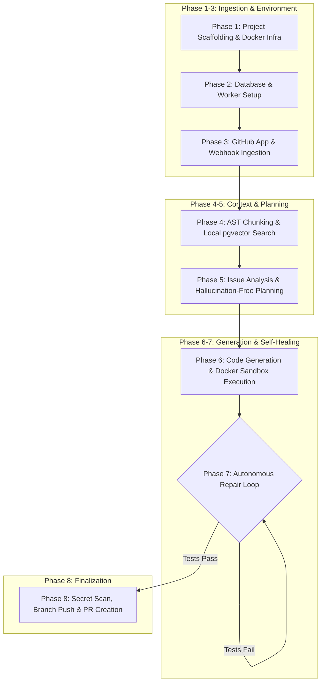

# Auto Issue Resolver — 8 Architecture & Implementation Phases

This document details the 8 core development and architecture phases of the **Auto Issue Resolver** (`auto-issue-solver`) project, mapping each phase to its functional goals, components, and codebase files.

---

## Architecture Flow

---

## 1. Phase 1: Project Architecture & Repository Structure
- **Objective**: Establish the foundation of the project repository, container orchestration, and isolated runtime configurations.
- **Key Deliverables**:
  - Root directory layout: `backend/`, `frontend/`, and `sandbox/`.
  - [docker-compose.yml](file:///c:/Users/ranaw/Desktop/mini%20project/auto-issue-solver/docker-compose.yml): Boots PostgreSQL with `pgvector` and Redis.
  - [backend/requirements.txt](file:///c:/Users/ranaw/Desktop/mini%20project/auto-issue-solver/backend/requirements.txt): Core Python dependencies.
  - [.env.example](file:///c:/Users/ranaw/Desktop/mini%20project/auto-issue-solver/.env.example): Environment variable templates.
  - [backend/Dockerfile](file:///c:/Users/ranaw/Desktop/mini%20project/auto-issue-solver/backend/Dockerfile) and [sandbox/Dockerfile](file:///c:/Users/ranaw/Desktop/mini%20project/auto-issue-solver/sandbox/Dockerfile): Production API and ephemeral execution containers.

---

## 2. Phase 2: Database & Backend Setup
- **Objective**: Design the relational database models, vector table embeddings, message queue, and basic API endpoints.
- **Key Deliverables**:
  - Relational & vector schemas using SQLAlchemy and Alembic migrations.
  - Core domain models ([app/models/domain.py](file:///c:/Users/ranaw/Desktop/mini%20project/auto-issue-solver/backend/app/models/domain.py)): `Repository`, `Issue`, `AgentRun`, `CodeChunk`, `AgentAction`, and `PullRequest`.
  - Redis queue wrapper ([app/services/queue_service.py](file:///c:/Users/ranaw/Desktop/mini%20project/auto-issue-solver/backend/app/services/queue_service.py)) with `LPUSH`/`BRPOP`.
  - Background queue consumer worker ([app/workers/issue_worker.py](file:///c:/Users/ranaw/Desktop/mini%20project/auto-issue-solver/backend/app/workers/issue_worker.py)).
  - FastAPI endpoints for health, issue tracking, and agent runs.

---

## 3. Phase 3: GitHub Authentication & Repository Connection
- **Objective**: Connect the system securely to GitHub using a GitHub App and safely isolate git clone operations.
- **Key Deliverables**:
  - GitHub App authentication using short-lived installation JWTs via [app/services/github_service.py](file:///c:/Users/ranaw/Desktop/mini%20project/auto-issue-solver/backend/app/services/github_service.py).
  - Webhook listener ([app/api/webhooks.py](file:///c:/Users/ranaw/Desktop/mini%20project/auto-issue-solver/backend/app/api/webhooks.py)) with HMAC SHA-256 signature verification.
  - `GitWorkspace` container managing isolated repository clones inside temporary directories (`tempfile.TemporaryDirectory`) on dedicated `agent/issue-<num>-run-<id>` branches.

---

## 4. Phase 4: Repository Intelligence & Semantic Code Retrieval
- **Objective**: Parse codebases using AST symbol boundaries and store embeddings for semantic similarity search.
- **Key Deliverables**:
  - AST-aware code chunking ([app/services/code_chunker.py](file:///c:/Users/ranaw/Desktop/mini%20project/auto-issue-solver/backend/app/services/code_chunker.py)).
  - Local vector embeddings using `sentence-transformers/all-MiniLM-L6-v2` (384-dimensional vectors in [app/services/embedding_service.py](file:///c:/Users/ranaw/Desktop/mini%20project/auto-issue-solver/backend/app/services/embedding_service.py)), eliminating external API dependencies.
  - Repository indexer ([app/services/repository_indexer.py](file:///c:/Users/ranaw/Desktop/mini%20project/auto-issue-solver/backend/app/services/repository_indexer.py)) and pgvector cosine retriever ([app/services/code_retriever.py](file:///c:/Users/ranaw/Desktop/mini%20project/auto-issue-solver/backend/app/services/code_retriever.py)).

---

## 5. Phase 5: Issue Analysis & Solution Planning Agent
- **Objective**: Extract structured problem constraints from GitHub issues and formulate a strictly validated repair plan.
- **Key Deliverables**:
  - `IssueAnalyzer` ([app/agents/issue_analyzer.py](file:///c:/Users/ranaw/Desktop/mini%20project/auto-issue-solver/backend/app/agents/issue_analyzer.py)) producing structured `IssueAnalysis` outputs.
  - `ContextBuilder` ([app/agents/context_builder.py](file:///c:/Users/ranaw/Desktop/mini%20project/auto-issue-solver/backend/app/agents/context_builder.py)) assembling relevant AST chunks and repository file lists.
  - `PlannerAgent` ([app/agents/planner.py](file:///c:/Users/ranaw/Desktop/mini%20project/auto-issue-solver/backend/app/agents/planner.py)) generating a `SolutionPlan` while preventing path traversal and hallucinated filenames.

---

## 6. Phase 6: Code Generation & Execution
- **Objective**: Generate precise file modifications and execute unit tests in an isolated sandbox.
- **Key Deliverables**:
  - `CodingAgent` ([app/agents/coding_agent.py](file:///c:/Users/ranaw/Desktop/mini%20project/auto-issue-solver/backend/app/agents/coding_agent.py)) producing structured `CodeChangePlan` patches.
  - `PatchService` ([app/services/patch_service.py](file:///c:/Users/ranaw/Desktop/mini%20project/auto-issue-solver/backend/app/services/patch_service.py)) applying patches safely with directory-traversal and `.git/` protection.
  - `TestRunner` ([app/sandbox/test_runner.py](file:///c:/Users/ranaw/Desktop/mini%20project/auto-issue-solver/backend/app/sandbox/test_runner.py)) executing test suites inside isolated Docker containers (`network_mode='none'`, memory capped).

---

## 7. Phase 7: Autonomous Loop & Sandbox Repair (Self-Healing Loop)
- **Objective**: Automatically diagnose test failures and iterate through targeted fixes until tests pass.
- **Key Deliverables**:
  - `FailureAnalyzer` ([app/agents/failure_analyzer.py](file:///c:/Users/ranaw/Desktop/mini%20project/auto-issue-solver/backend/app/agents/failure_analyzer.py)) parsing test error logs and stack traces into structured `FailureAnalysis`.
  - `RepairPlanner` ([app/agents/repair_planner.py](file:///c:/Users/ranaw/Desktop/mini%20project/auto-issue-solver/backend/app/agents/repair_planner.py)) formulating corrective code modifications.
  - Autonomous repair workflow ([app/workflows/repair_graph.py](file:///c:/Users/ranaw/Desktop/mini%20project/auto-issue-solver/backend/app/workflows/repair_graph.py)) executing the test-debug loop with maximum attempt ceilings.

---

## 8. Phase 8: Pull Request Automation & Finalization
- **Objective**: Safeguard code changes and publish the automated fix as a Pull Request on GitHub.
- **Key Deliverables**:
  - Pre-commit secret scanning via `validate_no_secrets` blocking accidental credential leaks.
  - Git staging, commit generation, and remote branch push over HTTPS using temporary App tokens.
  - Pull Request opening (`create_pull_request`), database `PullRequest` record creation, and informative status commenting on the original issue.

---

## Subsequent Extension Phases
- **Phase 9: Frontend Dashboard**: Vite + React + Tailwind CSS dashboard visualizing repositories, issues, agent execution states, and pull request outcomes.
- **Phase 10: Multi-User Authentication**: GitHub OAuth login flow, session cookie management, and user repository ownership isolation.
